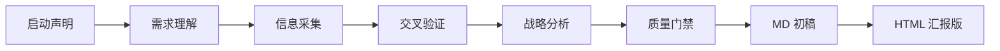

<!-- origin: 094CY/research-buddy -->
# ResearchBuddy

> 从「事实采集」到「战略推导」或「知识体系梳理」的全链路调研分析 Skill：输出 Markdown 初稿与 HTML 定稿汇报版。
> 本仓库是一个 **Agent Skill**，不是可运行的软件项目：没有后端、环境变量、部署步骤，也不需要配图。

## 这是什么

不是信息汇总工具，而是**从信息到洞察的转化引擎**。竞品调研不止于「竞品是什么」，
更要回答「所以我们该怎么做」；技术选型不止于「列一堆框架」，更要回答
「为什么选这个、不选那个、MVP 阶段选什么、规模化后怎么升级」。

支持产品竞品调研、商业化评估、技术选型、行业研究、市场分析、开源生态调研、
知识体系整理，以及 App / Web / SaaS 的全栈技术选型，可任意组合。
所有数据必须来自官网、官方文档、GitHub、权威报告，并标注来源。

## 安装

把本仓库**整个目录**复制到你的 Agent 技能目录：

```
# 示例：兼容 Agent Skills 的客户端
cp -R research-buddy ~/.claude/skills/

# 示例：项目级技能
cp -R research-buddy <你的项目>/.claude/skills/
```

技能入口是 `SKILL.md`；`references/` 是按需加载的资源，需与 `SKILL.md` 保持同级，
不要只复制单个文件。技能本身零依赖，`config.json` 只提供功能描述。

> 兼容性说明：`SKILL.md` 的 `name` 保留原平台的 `ResearchBuddy` 以兼容既有加载方式。
> 若客户端要求 `name` 与目录名严格一致，请把目录命名为 `ResearchBuddy`，
> 或把 frontmatter 的 `name` 改为 kebab-case 的 `research-buddy`。

## 目录结构（完整清单）

| 路径 | 作用 |
|---|---|
| `SKILL.md` | 技能定义：调研模式、红线原则、Phase 0–7 流程、交付与版本规范 |
| `config.json` | 技能功能描述（平台配置） |
| `references/commercial-analysis.md` | 商业化评估框架与定价核查 |
| `references/report-template.md` | Markdown / HTML 报告模板 |
| `references/research-types.md` | 调研类型与全栈技术选型对照表 |
| `references/strategic-frameworks.md` | 战略推导框架 |
| `references/style-guide.md` | 报告排版与可视化样式规范 |

## 工作流



快速调研模式跳过 Phase 4、不产出 HTML；深度调研模式执行完整 Phase 0–7。

## 使用

提及调研、分析、研究、对比、评估、选型、竞品、市场、商业化、行业、知识体系、全景图、
技术栈、框架选型等词即可触发。技能会先声明当前任务状态，再按模式推进。

红线：严禁编造数据；关键数据（定价 / 市场规模 / 技术参数）至少访问官方原始页面确认；
事实与分析分离；官方未明确的写「官网未公开」，不推测。

## 许可与作者

非商业研究与学习许可，仅供个人学习、研究与非商业技术交流；禁止任何商业用途。完整条款见 [LICENSE](./LICENSE)。

Copyright (c) 2026 094CY · https://github.com/094CY
